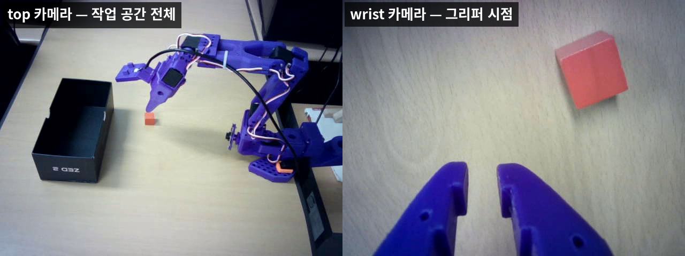
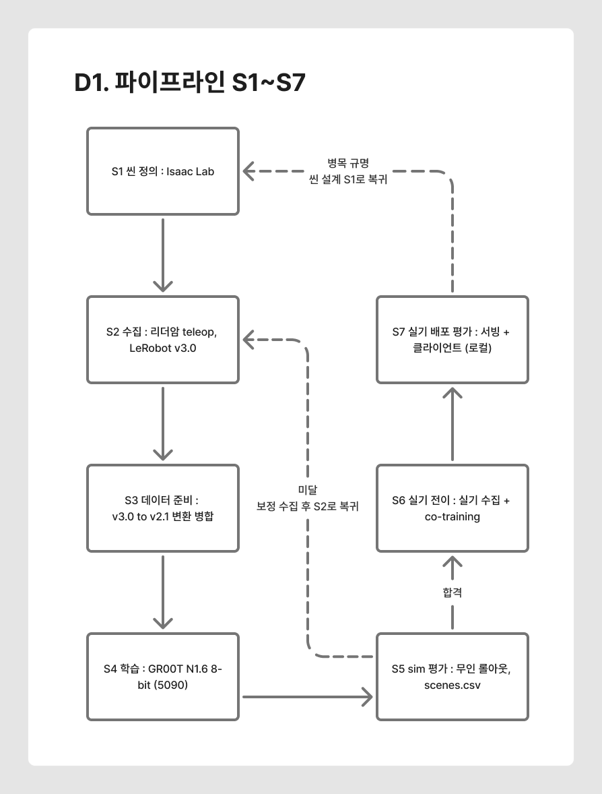
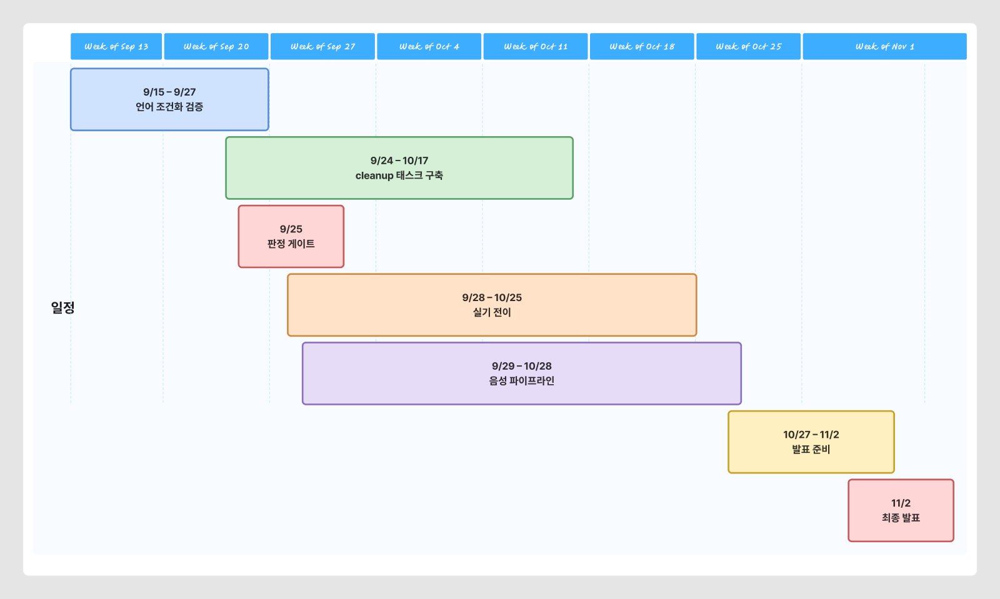
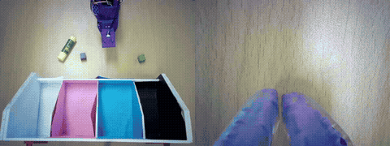
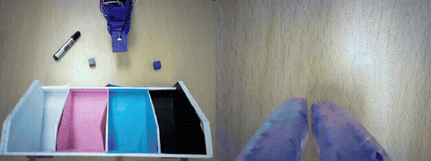
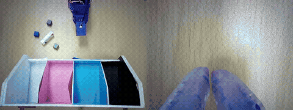

# 말하면 치우는 로봇 — Language-Guided Tabletop Cleanup

> **"빨간 물건은 왼쪽 상자에, 파란 물건은 오른쪽 상자에 넣어줘"** 라고 말하면
> SO-ARM101이 테이블 위 물체를 골라 분류하고, 완료를 음성으로 알린다.


---

## 0. 개요

### 무엇을 만드는가

음성 지시 → **VLA(Vision-Language-Action) 모델** → 로봇 동작 → 음성 피드백까지,
sim2real 파이프라인 전체를 잇는다. 모델은 NVIDIA **GR00T N1.6**(3B)를 쓴다.

<a href="docs/diagrams/D8_workspace.png"></a>

<sub>클릭하면 원본 크기 · 📐 편집: [Figma — D8 물리적 작업 공간](https://www.figma.com/board/4iKjT0Ngfm8IKmiFttKaKc?node-id=9-270)</sub>

**작업 공간 구성.** 60×40cm 테이블 위에 물체 3~5개를 무작위로 놓고, **좌·우 두 상자**에 분류한다.
카메라는 작업 공간 전체를 보는 **top**과 그리퍼에 달린 **wrist** 둘이고, 시연 수집은 **리더암**으로 한다.
Phase 2에서 **마이크·스피커**가 새로 들어간다 — 음성으로 지시하고 음성으로 보고받기 위해서다.

### 어디까지 왔고, 무엇이 남았는가

| | Phase 1 (완료) | **Phase 2 — 현재(10/13)** | Phase 2 목표 |
|---|---|---|---|
| 물체 | 빨간 큐브 1개 | **큐브 6색 + 사물 4종 = 10종** | (달성) |
| 지시 | 고정 문장 1개 | **가변 문장, 색상으로 물체·목적지 모두 지정** | 음성 입력 |
| 동작 | 1회 pick-and-place | **1회 pick-and-place (실기)** | N회 순차 분류 |
| 목적지 | 검은 상자 1개 | **4칸 선반(black·cyan·pink·white)** | (달성, 2개→4개로 확장) |
| 인터페이스 | 없음 | 없음 | **STT + TTS 양방향** |

> **계획과 다르게 간 지점.** 원래 §3 일정은 sim에서 cleanup 씬을 먼저 확장(W3)하고
> 학습한 뒤(W4) 실기로 옮기는(W5) 순서였다. 실제로는 **sim cleanup 단계를 생략하고
> 바로 실기 데이터를 모아 학습·평가**했다(10/6~10/13, 아래 상세). 그 결과 목적지
> 선택(색상 4지선다)은 **96% 로 사실상 해결**됐고, 지금 병목은 물체 선택과
> 파지 안정성이다 — sim 언어 조건화에서 나온 예측과 같은 방향이다.


### 이번 기간의 핵심 질문 — **답이 나왔다**

> **"모델이 지시문을 실제로 읽게 만들 수 있는가?"** → **그렇다. 단, 출발점이 전부다.**

Phase 1에서 정책이 언어를 사실상 무시한다는 것이 확인됐다. 분류 태스크는 이 능력 없이
성립하지 않으므로 여기부터 검증했고, **9월 말에 답을 얻었다**(§2.2).

같은 280 에피소드로 학습해도 **어디서 출발하느냐**가 결과를 갈랐다.

| 출발점 | 물체 선택률 (우연 25%) |
|---|---|
| 기존 모델 `v4_200`(빨간 큐브 전용)에서 이어서 | 22.5% — 우연 수준 |
| **파운데이션 모델에서 새로** | **47.5%** — 합격 |

빨간 큐브 하나에 86k step 최적화된 모델은 그 편향과 싸우느라 언어를 얻지 못하고
**기존 성능까지 27%p 잃었다**. 파운데이션 모델에서 출발하면 싸울 상대가 없다.

### 기대 성과

- 음성 명령으로 다물체를 분류하는 **실기 데모**
- sim2real + 언어 조건화 파이프라인의 **재현 가능한 문서·스크립트**
- 실패를 포함한 **실측 기록** (무엇이 왜 안 되는지)

---

## 1. 개발 환경

### 머신 2대 분리

| 머신 | GPU | 역할 |
|---|---|---|
| **로컬** | RTX 5070 Ti (16GB) | 데이터 수집(리더암), 실기 로봇 제어, 추론 서빙 |
| **원격 5090** | RTX 5090 (32GB) | 모델 학습, Isaac Sim 무인 평가 |

> 리더암·로봇이 로컬에 물려 있어 **수집과 실기는 로컬에서만** 가능하고,
> 16GB로는 학습이 안 돼 **학습은 5090 전용**이다.

### 하드웨어

| 장비 | 사양 | 용도 |
|---|---|---|
| 로봇 | SO-ARM101 (6-DOF + 그리퍼) | 매니퓰레이션 |
| 리더암 | SO-ARM101 | teleop 시연 수집 |
| 카메라 | USB ×2 (top + wrist) | 시각 입력 640×480 |
| 마이크 / 스피커 | USB | 음성 입출력 (Phase 2 신규) |



<sub>정책이 받는 두 장. 왼쪽 top 카메라에 로봇과 작업 공간 전체가, 오른쪽 wrist 카메라에 그리퍼 시점이 들어온다.</sub>

### 소프트웨어

| 레이어 | 기술 |
|---|---|
| 시뮬레이터 | Isaac Sim / Isaac Lab 2.3.2 |
| VLA 모델 | GR00T N1.6 (3B, 8-bit) |
| 데이터 | LeRobot v3.0 수집 → GR00T v2.1 변환 |
| 음성 | Whisper (STT) · gTTS/Piper (TTS) |

---

## 2. 시스템 아키텍처 블록도

### 전체 파이프라인 7단계

<a href="docs/diagrams/D1_pipeline.png"></a>

> 단계별 상세와 태스크 교체 시 바꿀 부분은 [PIPELINE.md](PIPELINE.md)에 정리돼 있다.

### 추론(배포) 흐름

<a href="docs/diagrams/D3_infer_pipeline.png"></a>

마이크·카메라는 모두 **로컬 5070 Ti 한 대**에 붙는다. 음성은 STT를 거쳐 영어 지시문이 되고,
**영상 2채널 + 로봇의 관절 상태**와 함께 GR00T 정책에 들어간다. 정책이 내놓은 16-step 행동 청크를
앙상블로 다듬어 SO-ARM101이 실행하고, 완료를 판정해 스피커로 알린다. 별도 서빙 서버는 필요 없다.

### 학습 흐름

<a href="docs/diagrams/D2_train_pipeline.png"></a>

로컬에서 사람이 시연해 모으고, 5090이 변환·학습·평가한다.

---

## 2.1 일정 간트차트

### 요약 — 5개 축

<a href="docs/diagrams/D10_gantt_summary.png"></a>

<sub>클릭하면 원본 크기 · 📐 편집: [Figma — D10 일정 요약](https://www.figma.com/board/4iKjT0Ngfm8IKmiFttKaKc?node-id=23-393)</sub>

| 축 | 기간 | 끝나야 하는 것 |
|---|---|---|
| **언어 조건화 검증** | 09/15 ~ 09/26 | 지시문을 읽는가에 대한 답 (판정 게이트 09/25) |
| **cleanup 태스크 구축** | 09/24 ~ 10/17 | 다물체·순차 분류 sim 모델 |
| **실기 전이** | 09/28 ~ 10/25 | 실물 로봇에서 동작 |
| **음성 파이프라인** | 09/29 ~ 10/28 | 음성 명령 → 동작 → 음성 보고 |
| **발표 준비** | 10/27 ~ 11/02 | 데모 영상·발표 자료 |


- **독립적인 작업은 겹쳐서 진행**한다. 특히 두 가지가 전체 일정을 줄인다:
  - **음성 파이프라인(STT/TTS)** 은 로봇·GPU와 무관하므로 9월 말부터 미리 만든다
  - **실기 프롭 준비·카메라 정렬**은 조달 시간이 있어 10월 초에 착수한다

---

## 2.2 현재 구현 결과

### so-arm 101 동작 

**sim 동작** - isaac sim으로 구성한 scene 안에서 


**실기 동작** — 같은 태스크를 co-training 모델로 실물 로봇에서


### 언어 조건화용 sim 씬 


<sub>**같은 화면인데 지시문이 다르면 정답 궤적이 달라진다** — 이 구성이 있어야 모델이 언어를 볼 이유가 생긴다.</sub>

### 언어 조건화 판정 결과 (2026-09-27)

280 에피소드를 수집해 학습하고, **10개 조건 × 30 에피소드**를 무인으로 굴려 판정했다.
핵심은 **대응쌍** — 같은 화면·같은 배치에서 **문장만** 바꾼다.

| 지시문 | `v4_200`<br>(기존 모델) | `+280ep`<br>(이어서 학습) | **파운데이션<br>+280ep** |
|---|---|---|---|
| "**red** block을 상자에" | 23.3% | 26.7% | **60.0%** |
| "**blue** block을 상자에" | 6.7% | 30.0% | **46.7%** |
| "**eraser**를 상자에" | 0.0% | 20.0% | **46.7%** |
| "**marker**를 상자에" | 0.0% | 13.3% | **36.7%** |
| **물체 선택률** (120시행, 우연 25%) | 7.5% | 22.5% | **47.5% ✅** |

**가장 강한 증거는 대조군이다.** 아래 두 문장은 같은 화면에서 **같은 빨간 큐브**로 채점된다.

```
"Pick up the red block and place it in the box"   →  60.0%
"Pick up the cube and place it in the box"        →  23.3%   (큐브가 2개라 모호)
```

`red` 한 단어가 성공률을 **2.6배**로 올린다. 기존 모델 둘에서는 이 두 값이 같았다
(23.3 vs 26.7 / 26.7 vs 26.7) — 지시문이 행동에 관여하지 않았다는 뜻이다.

동의어 문형(`"Grab the blue cube ... container"`)에서 **53.3%** 로 더 높게 나온 것도 근거다.
문장 형식을 외운 것이 아니라 뜻을 읽는다.

> **부분 성공이다.** 물체 선택은 되지만 **목적지 선택은 약하다** — 노란 큐브를 어느 상자에
> 넣을지에서 갈색 상자로 2:1 치우친다. 이 축은 학습량을 늘려 다시 본다(진행 중).

### 실제로 지시문을 따르는 장면 — **같은 화면, 네 개의 문장**

아래 네 판은 **완전히 같은 배치**다(같은 씬, 같은 시드, 같은 에피소드 번호).
바뀐 것은 문장 하나뿐이고, 로봇은 매번 **다른 물체**를 집어 상자에 넣었다.


<sub>파운데이션 모델 + 280ep 학습본. 무인 롤아웃 중 **같은 에피소드(#07)** 의 네 조건 —
움직이지 않으면 [최종 장면 정지컷](docs/figures/lang_pair4_B6k.png)</sub>

| 문장 | 집은 것 | 화면에 함께 있던 것 |
|---|---|---|
| "Pick up **the red block**" | 🟥 빨간 큐브 | 파랑·지우개·마커 |
| "Pick up **the blue block**" | 🟦 파란 큐브 | 빨강·지우개·마커 |
| "Pick up **the eraser**" | 🟧 지우개 | 빨강·파랑·마커 |
| "Pick up **the marker**" | ⬛ 마커 | 빨강·파랑·지우개 |

**이것이 cleanup 태스크가 성립하는 근거다.** "치워"가 아니라 "**무엇을** 치워"를 알아들어야
다물체 분류가 가능하고, 그 능력이 실제 동작으로 확인됐다.

> 화면에 늘 네 물체가 함께 있다. 지시문을 읽지 않으면 어느 것을 집을지 알 수 없는 구성이며,
> 이것이 수집 단계부터 의도한 설계다(§2.2 위의 씬 그림).

### 실기(SO-ARM101) cleanup 결과 (2026-10-13)

sim cleanup 단계를 생략하고, 언어 조건화에서 확인한 두 가지(파운데이션에서 새로 시작·
저대비 색은 피할 것)를 그대로 실기에 적용했다. **4칸 선반**(black·cyan·pink·white,
우연 25%)에 **물체 10종**(큐브 6색 + 마커·지우개·풀·드라이버) 중 1~4개를 무작위로
놓고 색 지시문으로 물체와 목적지를 모두 지정한다.

| | v2 (checkpoint-21000) | **v3 (checkpoint-30000, 현재)** |
|---|---|---|
| 데이터 | 250ep · 지시문 40종 | **370ep** — 재파지·끝맺음 품질 개선분 120ep 추가 |
| 학습 | 파운데이션에서 새로 · 8.2 epoch | 파운데이션에서 새로 · 8.0 epoch |
| **목적지 축**(우연 25%) | 96.2% | **96.1%** — p<0.00001, 사실상 해결 |
| 물체 축(우연 ~35%) | 71.7% | 70.0% → **W 튜닝 후 90%**(아래) |
| 시행이 안 끝나고 타임아웃 | 42% (25/60) | 27% → **ensemble 튜닝 후 20%**, 그마저 원인 특정 |


<sub>실제 추론 영상(W=0.8, checkpoint-30000) — "Put the purple cube into the cyan bin".
화면에 큐브 3개가 함께 있고, 보라 큐브만 골라 cyan 칸에 넣은 뒤 **스스로 멈춘다**(모델엔
종료 신호가 없어 궤적으로 "이제 멈춰라"를 가르쳐야 했다 — 아래 참고).</sub>

**물체·목적지를 바꿔도 되는지** — 같은 체크포인트·같은 W로 돌린 세 장면을 더 둔다.
전부 60시행 중 완전 정답(물체·목적지 모두 일치)만 골랐다.



<sub>"glue stick → **pink**" — 큐브가 아닌 막대형 물체. 19.8초.</sub>



<sub>"marker → **white**" — 가늘고 파지가 까다로운 물체. 23.9초.</sub>



<sub>"blue cube → **black**" — 화면에 방해물 4개(eraser 포함). 26.8초.</sub>

**풀어낸 문제 셋.**

1. **타임아웃.** 작업을 끝내고도 추론이 안 멈춰 60초를 다 쓰는 시행이 많았다.
   원인은 두 겹이었다 — ① 모델에 종료 신호가 없어 "rest 복귀 후 유지"를 궤적으로
   직접 감지하는 로직을 클라이언트에 추가했고, ② 그 로직이 쓰는 전역 허용 오차(6°)가
   손목-롤(wrist_roll, 작업 성패와 무관한 자유도) 하나에 매번 걸렸다 — 그 관절만
   따로 15°로 풀어주니 "성공했는데 타임아웃"한 사례가 재현상 전부 해소됐다.
2. **동작 과평활.** 물체 위에서 길게(최대 52초) 얼어붙는 현상이 있었다. 원인은
   temporal ensembling의 가중치(W)였다 — 이 모델로 직접 재서(0.3/0.6/0.8, 각 10~60시행)
   **W=0.8**이 최장 배회를 52초→18초로, 물체 정확도를 70%→90%로 끌어올렸다. 기본값으로 고정했다.
3. **파지 불안정.** eraser처럼 납작한 물체가 재파지율 1위(20%)였다. 세운 자세
   시연을 추가해(v3의 +120ep 중 36행) eraser 정확도가 33%→83%로 올랐다.

**추론을 로컬로 옮겼다.** 지금까지 GR00T 추론은 5090(학습용 GPU)에 맡기고 로컬은
카메라·로봇만 제어했는데, **5070 Ti(16GB)에서 동일 체크포인트를 직접 서빙**하도록
인프라를 다시 짰다 — 네트워크 구간(5090↔로컬)이 사라져 지연·대역폭 변수가 빠진다.
학습은 여전히 5090 전용이지만, 평가·데모는 이제 로컬 한 대로 끝난다.

**색지 교체 검증 결론 (10/14, 53시행에서 중단).** 선반을 여러 교란 배치로
바꿔 "색을 읽는가, 칸 위치를 외웠는가"를 갈랐다. 결과는 **부분적**이다 —
학습 배치(대조군)는 100% 정확했고, 교란 배치에서도 black·cyan·pink는
대부분 정확히 따라갔다(오류율 0~14%). 그런데 **white만 유독 새는 경향**이
뚜렷했다: 두 배치(L2·L3)에서 white 지시 8건 전부가 **맨 왼쪽 칸**으로
착지했다 — 착지한 색 자체는 배치마다 달랐지만(pink, cyan) 물리 위치는
똑같이 1번이었다. "학습 때 자리를 외웠다"가 아니라 **"white를 확신 못 할 때
왼쪽 칸으로 기본 이동하는" 편향**으로 보인다. white는 채도가 없어 시각
신호가 가장 약한 색이라는 점과 맞는다.


<sub>"Put the blue cube into the **white** bin" — 실제 배치는 pink·cyan·black·white(왼쪽→오른쪽).
파란 큐브는 정답(맨 오른쪽 white)이 아니라 **맨 왼쪽 pink 칸**에 들어갔다.</sub>

**다음 수집에 반영**: 지금까지 선반은 학습 내내 한 고정 배치로만 서 있었다 —
색과 "그 색이 늘 있던 자리"가 통계적으로 완전히 얽혀, 분리해 배우지
못했을 가능성이 크다. 다음 데이터셋 수집에서는 **선반을 여러 물리 배치로
바꿔가며** 시연을 모아 이 결합을 끊는다.


---

## 3. 주차별 세부 계획

**7주 · 2026-09-15 ~ 11-02.** 2주차 판정 결과가 이후 일정을 가른다.

> 아래 주차 날짜는 **마감 기준**이다. 실제 진행은 [§2.1 간트차트](#21-일정-간트차트)처럼
> 병행 구간이 겹친다 — 음성 파이프라인과 실기 프롭 준비는 앞당겨 시작한다.

| 주 | 기간 | 주제 | 상태(10/13 기준) |
|---|---|---|---|
| W1 | 09/15 ~ 09/21 | 언어 조건화 — 데이터 수집·학습 | ✅ 완료 |
| W2 | 09/22 ~ 09/28 | 언어 조건화 — **판정 게이트** | ✅ 완료(부분) |
| W3 | 09/29 ~ 10/05 | cleanup 씬 확장 | ⏭️ 생략(실기 직행) |
| W4 | 10/06 ~ 10/12 | cleanup 수집·학습 | ✅ 완료(sim 대신 실기) |
| W5 | 10/13 ~ 10/19 | 실기 전이 (co-training) | 🔄 진행 중(성격 변경) |
| W6 | 10/20 ~ 10/26 | 음성 통합 | ⏳ 미착수 |
| W7 | 10/27 ~ 11/02 | **발표주** — 최종 데모·발표 | ⏳ 미착수 |

---

### W1 — 언어 조건화 데이터 수집·학습 ✅ **완료**

**목표**: 지시문이 행동을 가르는 데이터를 만들고 학습을 돌린다.

| 작업 | 결과 |
|---|---|
| sim 수집 **280ep** | 118,521 프레임 · 서로 다른 지시문 **100종** |
| 균형 검증 | 물체별 타깃 29~40 (기대 35) · **미학습 색 유출 0** |
| 학습 | 두 가지 출발점으로 각각 수행 (아래 W2) |

**검증 통과**: 에피소드당 지시문 정확히 1개 — **280/280**

> 수집 중 세 가지를 고쳤다. 마커가 그리퍼에 달라붙는 현상(원기둥 → 캡슐 교체),
> 영상 인코딩 정지(뷰어 끄기), 강제 종료로 잘린 데이터 파일.

---

### W2 — 판정 게이트 🚦 ✅ **통과 (부분)**

**목표**: *이 파이프라인에서 언어 조건 조작이 가능한가*에 답한다.

무인 롤아웃 **10조건 × 30ep**을 **세 모델**에 돌렸다(사람 0, 기계 약 12시간).

| 지표 | 합격선 | `v4_200` | `+280ep` | **파운데이션+280ep** |
|---|---|---|---|---|
| 물체 선택률 (우연 25%) | ≥45% | 7.5% | 22.5% | **47.5% ✅** |
| 목적지 선택률 (우연 50%) | ≥65% | 3.3% | 10.0% | 30.0% ❌ |
| 기존 성능 유지 | −2/10 이내 | 86.7% | 60.0% ❌ | 76.7% ✅ |

**판정: 물체 축은 통과, 목적지 축은 미달.** 그리고 **출발점이 결정적**이라는 것이
이번 기간의 가장 중요한 발견이다(§2.2).

**분기 — 실제로 간 길**

- ✅ 물체 선택 통과 → **W3 cleanup 확장으로 진행**
- ⚠️ 목적지 미달 → 학습량을 3.2 → 32 epoch으로 늘려 재판정 (진행 중, 9/29 완료)
- ❌ 색 기반 규칙 축소 → **쓰지 않는다**

> 도중에 **판정기 결함**을 발견해 결과를 다시 냈다. 접촉 센서가 빨간 큐브 하나만
> 감지하도록 설정돼 있어, 다른 물체를 올바르게 집어 넣어도 실패로 기록됐다.
> 영상을 눈으로 확인하는 과정에서 잡았다 — 자동 판정만 믿으면 안 된다는 교훈.

---

### W3 — cleanup 씬 확장 ⏭️ **생략 — 실기 직행으로 대체**

**원래 목표**: 1회 pick-place sim 씬을 **N회 순차 분류** 씬으로 바꾼다.

**실제로 간 길**: sim 씬 확장 대신 **바로 실기 데이터 수집**으로 넘어갔다. 언어
조건화에서 목적지 축이 약했던 원인(저대비 색)이 sim 씬 설정 문제였을 가능성이 커서,
sim을 또 고치기보다 **실기에서 바로 재설계**(4칸 선반·고대비 4색)하는 쪽을 택했다.
순차 분류(N회)는 아직 미착수 — W4 자리로 미뤄졌다.

---

### W4 — cleanup 수집·학습 ✅ **완료 (sim 대신 실기로)**

**목표**: 1회 pick-place를 실기에서 성립시킨다. (순차 분류는 다음 단계)

| 작업 | 결과 |
|---|---|
| 실기 수집 | **370ep**(v1 80 → v2 250 → v3 370, 색지 4색·물체 10종) |
| 학습 (5090) | 파운데이션에서 새로, 8.0 epoch, 약 8시간 |
| 실기 평가 (60시행, 무인 아님 — 사람이 판정) | **목적지 96.1%** · 물체 70~90% |

**완료 기준 재정의**: sim L1/L2 성공률 → **실기 목적지 선택 ≥ 65%**(언어 조건화 합격선과
동일 기준 적용) — **96.1%로 크게 초과 달성**. 물체 선택은 아직 보강 중(§2.2 상세).

> 상자 2개(좌/우)가 아니라 **4칸 선반**으로 갔다 — 우연이 50%→25%로 내려가 같은
> 표본으로 결론이 훨씬 또렷해진다. §0 표 참고.

---

### W5 — 실기 전이 🔄 **진행 중 (성격이 바뀜)**

**원래 목표**: sim 모델을 co-training으로 실물 로봇에 옮긴다.

**실제로 간 길**: W4에서 이미 **처음부터 실기 데이터로** 학습했으므로 "sim→실기 전이"
라는 원래 과제 자체가 없어졌다. 대신 이번 주는 **실기 모델 자체의 약점 보강**에
썼다 — temporal ensembling 튜닝(물체 축 70%→90%), 타임아웃 원인 수정, 추론을
5090→로컬(5070 Ti)로 옮겨 네트워크 변수 제거, 그리고 **"색을 읽는지 위치를 외웠는지"**
가르는 색지 교체 검증(진행 중, §2.2).

**완료 기준**: 실기 목적지 ≥ 65% → **달성(96.1%)**. 색지 교체 검증 결과가 이 주의
마지막 질문이다 — 위치 암기로 밝혀지면 수집 설계를 다시 봐야 한다.

> Phase 1 실측: sim 모델의 **zero-shot 전이는 0%**였다. 이번엔 sim 경유 없이
> 처음부터 실기로 학습해 그 문제 자체를 비켜 갔다.

---

### W6 — 음성 통합

**목표**: 음성으로 지시하고 음성으로 보고받는다.

| 작업 | 비고 |
|---|---|
| STT (Whisper) → 한국어 → 영어 지시문 | push-to-talk |
| TTS 피드백 | "빨간 펜 정리 완료" |
| end-to-end 연결 | 마이크부터 스피커까지 |

**완료 기준**: 음성 명령 한 번으로 분류 1회 성공

---

### W7 — 발표주 🎤

**목표**: 11/02(월) 최종 발표. 앞주까지의 결과를 데모와 자료로 굳힌다.

| 일자 | 작업 |
|---|---|
| 10/27(화) | 데모 시나리오 확정 — 성공 조건과 실패 시 대체 시연까지 정한다 |
| 10/28(수) | 리허설 촬영 · 실패 지점 보완 |
| 10/29(목) | **최종 데모 영상 촬영** (음성 명령 → 분류 → 음성 보고) |
| 10/30(금) | 성능 정리 (sim/실기, 레벨별) · 발표 자료 작성 |
| 10/31(토)~11/01(일) | 예비일 — 재촬영·자료 다듬기 |
| **11/02(월)** | **최종 발표** |

**완료 기준**: 데모 영상 + 발표 자료 + 최종 리포트

> **데모는 실패를 전제로 준비한다.** 실기 성공률이 100%가 아니므로, 현장 시연 1회에
> 걸지 않고 **녹화 영상을 주로, 현장 시연을 보조로** 둔다. 실패 장면도 원인과 함께 보여준다.

---

### 일정 리스크

| 리스크 | 영향 | 대응 |
|---|---|---|
| **언어 조건화 실패** (W2) | 프로젝트 핵심 가정이 깨짐 | 색 기반 규칙 분류로 축소, 데모는 유지 |
| **물체 기하 실패** | 펜·매직을 못 잡음 | Phase 1에서 이미 확인된 약점 — 크기·형상 다양성을 수집에 반영 |
| **학습 시간 초과** | 주차 밀림 | 5090 점유 일정을 주 단위로 고정, 야간 가동 |
| **순차 판정 설계 지연** (W3) | W4 수집 지연 | 판정을 좌표 기반으로 자동화 (사람이 영상 안 봄) |

---

## 4. 프로젝트 구조

```
manipulator_ws/
├─ README.md            프로젝트 개요
├─ PIPELINE.md          파이프라인 해부 (단계별 재현 절차)
├─ PRESENTATION.md      이 문서 — 발표·일정
├─ manipulator_md/      실험 기록·계획서 (sim / sim2real)
├─ setup/               재현용 스크립트 (sim · gr00t · 하드웨어 · 음성)
├─ envs/                실행 환경 (lerobot · gr00t)
├─ inf_video/           추론 영상·평가 결과
└─ docs/                다이어그램·발표 이미지
```

---

## 5. 참고 자료

| 자료 | 링크 |
|---|---|
| GR00T N1.5 (모델 설계·언어 추종) | https://research.nvidia.com/labs/gear/gr00t-n1_5/ |
| Isaac GR00T 파인튜닝 | https://github.com/NVIDIA/Isaac-GR00T |
| LeRobot (데이터·로봇 제어) | https://github.com/huggingface/lerobot |
| SO-ARM101 sim2real 워크숍 | https://github.com/ycheng517/Sim-to-Real-SO-101-Workshop |
| 아키텍처 다이어그램 (FigJam) | https://www.figma.com/board/4iKjT0Ngfm8IKmiFttKaKc |

### 내부 문서

| 문서 | 내용 |
|---|---|
| [PIPELINE.md](PIPELINE.md) | 7단계 파이프라인, 태스크 교체 체크리스트 |
| [sim2real 보고서](manipulator_md/sim/sim2real_generalization_report.md) | Phase 1 전이·일반화 실측 |
| [언어 조건화 복원 계획](manipulator_md/sim/language_conditioning_plan.md) | 세 접근의 비교·선택 |
| [1단계 실행 계획](manipulator_md/sim/language_conditioning_sim_plan.md) | 씬·수집·학습·평가 설계 |
