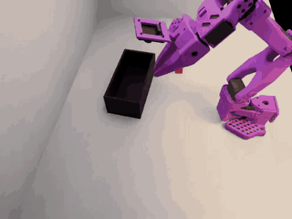
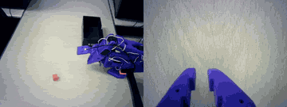
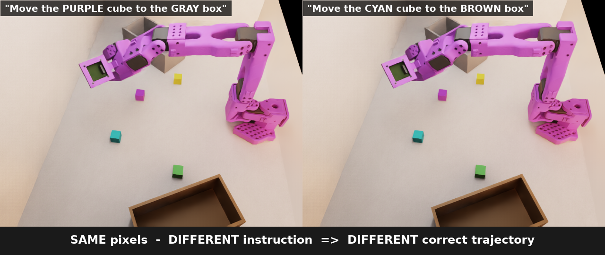
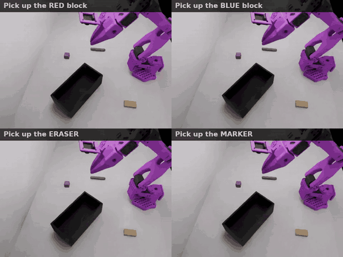
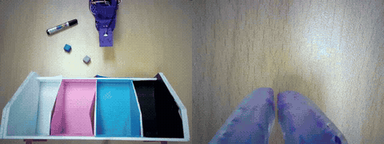

# 양팔 SO-ARM101 언어 지시 분류 — Bimanual Handoff Sorting

> **"Put the glue stick into the pink bin"** 이라고 지시하면, 오른팔이 테이블 위 물체 중
> **glue stick 을 골라 집고**, 왼팔에 **직접 건네고**, 왼팔이 **pink 칸**에 넣는다.

---

## 0. 개요


https://billowy-water-a69.notion.site/cleanup-151ep-300ep-3fbd17f852678110a4c5efea15523346?source=copy_link

https://billowy-water-a69.notion.site/cleanup-300ep-3fed17f8526781428a45ddc7bd70ee15?source=copy_link


### 무엇을 만드는가

지시문 한 문장 → **VLA(Vision-Language-Action) 모델** → 양팔 동작까지 하나의 정책으로 잇는다.
모델은 NVIDIA **GR00T N1.6**(3B)이고, 한 문장이 두 팔을 동시에 조건화한다.

| 팔 | 맡는 판단 | 동작 |
|---|---|---|
| **오른팔** | **물체 분류** — 1~4개 중 지시한 물체(8종) | 집기 → 왼팔에 전달 |
| **왼팔** | **색 분류** — 2×2 칸 중 지시한 색(4색) | 받기 → 칸에 넣기 |

> 📐 **작업 공간 그림 다시 작성 예정** — 두 팔·물체 영역·2×2 보관함·전달 위치·카메라 3대.

### 어디까지 왔고, 무엇이 남았는가

sim 에서 물체 하나를 상자 하나에 넣는 것부터 시작해 단계마다 막힌 원인을 고치며 넓혀 왔다.

| 단계 | 과제 | 결과 | 다음 단계로 넘긴 것 |
|---|---|---|---|
| P1·P2 | sim 큐브 → 상자, 실기 전이 | 실기 co-training **90%** | 실패 원인은 모델보다 **데이터·배포 루프** |
| P3 | sim 일반화 | sim OOD 82.5% | 정책이 **지시문을 읽지 않음** |
| P4 | sim 언어 조건화 | 물체 선택 47.5%(우연 25%) | **파운데이션에서 새로** 학습해야 언어가 붙음 |
| P5 | 실기 분류 단일팔 | **목적지 96.1% · 물체 90%** | 칸 **위치**를 외우는 편향 → 배치를 바꿔 가며 수집 |
| **P6** | **실기 분류 양팔 (최종 과제)** | 151ep: 전달 92%, 물체·목적지는 우연 수준 | **300ep(칸 배치 6종) 학습 중** |

### 핵심 질문

> **"한 문장으로 두 팔이 각자 다른 판단(물체 / 색)을 하게 만들 수 있는가?"**

단일팔에서는 한 팔이 물체와 칸을 모두 골랐다. 양팔에서는 **물체 판단은 오른팔, 색 판단은 왼팔**로 나뉘고,
그 사이에 **전달**이 끼어 지시문이 행동을 정하는 구간이 길어진다. 151ep 에서는 조작(집기·전달·넣기)은
되지만 두 판단 모두 우연 수준이었다 — 300ep 로 이것이 데이터 양 문제인지 가린다.

### 기대 성과

- 지시문 한 문장으로 동작하는 **양팔 분류 실기 데모**
- 평가 A(151ep ↔ 300ep 비교) · 평가 B(학습에 없던 칸 배치 포함)로 **물체 축·목적지 축을 분리한 실측**
- sim → 실기 → 양팔까지 이어지는 **재현 가능한 스크립트·기록** (실패 포함)

---

## 1. 개발 환경

### 머신 2대 분리

| 머신 | GPU | 역할 |
|---|---|---|
| **로컬** | RTX 5070 Ti (16GB) | 양팔 teleop 수집, 실기 로봇 제어, 추론 서빙 |
| **원격 5090** | RTX 5090 (32GB) | 모델 학습 (300ep 10 epoch ≈ 43시간) |

> 리더암·로봇이 로컬에 물려 있어 수집과 실기는 로컬에서만 가능하고, 16GB 로는 학습이 안 돼 학습은 5090 전용이다.

### 하드웨어

| 장비 | 사양 | 용도 |
|---|---|---|
| 팔로워 | SO-ARM101 ×2 (각 6-DOF + 그리퍼) | 오른팔 집기·전달 / 왼팔 받기·넣기 (12관절) |
| 리더 | SO-ARM101 ×2 | 양팔 teleop 시연 |
| 카메라 | USB ×3 — top · 왼손목 · 오른손목 | 시각 입력 640×480 |
| 보관함 | 2×2 칸 — black · cyan · pink · white | 왼팔 쪽, 50ep 마다 색 배치 교체 |

> 📐 **카메라 3대 시점 그림 다시 작성 예정** (top · 왼손목 · 오른손목이 정책에 들어가는 세 장)

### 소프트웨어

| 레이어 | 기술 |
|---|---|
| VLA 모델 | GR00T N1.6 (3B, 8-bit 옵티마이저), 양팔 설정 `bi_so100_config.py` |
| 데이터 | LeRobot v3.0 수집 → GR00T v2.1 변환 |
| 로봇 제어 | lerobot 0.4.4 (`bi_so_follower`) |
| 시뮬레이터 | Isaac Sim / Isaac Lab 2.3.2 (P1~P4) |

---

## 2. 시스템 아키텍처 블록도

> 📐 **블록도 다시 작성 예정** — 아래 세 장.

### 전체 파이프라인

계획표 → 양팔 수집 → 검증(전달 검사) → 변환 → 학습 → 서빙 → 평가. 단계별 재현 절차는 [PIPELINE.md](PIPELINE.md).

### 추론(배포) 흐름

카메라 3장 + 12관절 상태 + 지시문 → GR00T 정책(로컬 서빙) → 16-step 행동 청크 → 시간 앙상블 → 양팔.
양팔이 rest 근처에서 멈추면 종료하고, 어떤 이유로 끝나든 그 자리 정지 → 천천히 rest 복귀 → 토크 유지.

### 학습 흐름

로컬에서 시연을 모아 5090 으로 보내 변환·학습하고, 체크포인트를 로컬로 받아 서빙한다.

---

## 2.1 일정 간트차트

> 📐 **간트차트 다시 작성 예정** — 아래 표 기준.

| 축 | 기간 | 끝나야 하는 것 |
|---|---|---|
| 양팔 수집·1차 학습 | 10/14 ~ 10/16 | 300ep 수집 · 151ep 중간 학습·평가 ✅ |
| **300ep 학습** | 10/17 ~ 10/18 | `gr00t_bi_cleanup300_n16_8bit` (10 epoch) |
| **평가 A · B** | 10/19 ~ 10/21 | 151ep ↔ 300ep 비교(36시행), 미학습 칸 배치 포함 종합(60시행) |
| **개선** | 10/21 ~ 10/26 | 판정 기준에 따라 — 비전 인코더 학습 / 추가 수집 / 전달 교착 대응 |
| **발표 준비** | 10/27 ~ 11/02 | 데모 영상·발표 자료 |

---

## 2.2 현재 구현 결과

### P1~P3 — sim 에서 실기로



<sub>sim(Isaac Sim) — 블록을 상자에 넣는 기본 과제.</sub>



<sub>실기 — 같은 과제를 sim + 실기 co-training 모델로. 실기 데이터 50ep 를 더한 것만으로 10% → 90%.</sub>

### P4 — 정책이 지시문을 읽게 만들기 (sim)

P3 까지의 정책은 지시문을 바꿔도 같은 행동을 했다(학습 데이터 지시문이 1종). **같은 화면·다른 문장**으로
수집해 다시 학습했고, **출발점**이 결과를 갈랐다.



| 출발점 | 물체 선택률 (우연 25%) |
|---|---|
| 기존 모델에서 이어서 | 22.5% — 우연 수준 |
| **파운데이션 모델에서 새로** | **47.5%** |



<sub>완전히 같은 배치에서 문장만 바꾼 네 조건 — 매번 다른 물체를 집는다
(정지컷: [lang_pair4_B6k.png](docs/figures/lang_pair4_B6k.png)).</sub>

### P5 — 실기 분류 (단일팔)

4색 칸 선반에 물체 10종 중 1~4개를 놓고, 지시문으로 물체와 칸을 모두 정한다. 370ep, 파운데이션에서 새로 학습.

| 지표 | 결과 |
|---|---|
| 목적지 (우연 25%) | **96.1%** |
| 물체 (우연 ~35%) | 70% → 앙상블 W 튜닝 후 **90%** |



<sub>"Put the purple cube into the cyan bin" — 큐브 3개 중 보라만 골라 cyan 칸에 넣고 스스로 멈춘다.</sub>

**칸 위치 교체 검증** — 칸 색 배치를 바꿔 보니 black·cyan·pink 는 대부분 따라갔지만 **white 는 맨 왼쪽 칸으로**
새는 경향이 있었다. 학습 내내 칸이 한 배치로만 서 있어 색과 위치가 얽혔기 때문으로 보고,
**양팔 수집에서는 50ep 마다 칸 색 배치를 바꿨다.**


### P6 — 실기 분류 (양팔, 최종 과제)

| 항목 | 내용 |
|---|---|
| 데이터 | 300ep · 331,455 프레임 · 지시문 32종 · 칸 배치 6종 (수집 완료 10/16, 전달 300/300 검출) |
| 1차 학습 | 앞 151ep(칸 배치 3종)로 10 epoch |
| 2차 학습 | 300ep 전체로 10 epoch — **진행 중** (10/17 시작, 약 43시간) |

**151ep 평가 (36시행)**

| 단계 | 결과 | 우연 |
|---|---|---|
| ① 오른팔이 지시한 물체를 집음 | 19/36 (53%) | 약 35% |
| ② 전달 성공 | **33/36 (92%)** | — |
| ③ 왼팔이 지시한 칸에 넣음 | 11/33 (33%) | 25% |
| 완전 성공 | 8/36 (22%) | — |

**조작은 되지만 두 판단이 약하다.**

1. **색 분류(왼팔)** — 같은 물체로 목적지만 바꿔도 black 칸에 쏠린다(넣은 칸 45% 가 black).
   단일팔에서 white 에만 보였던 편향이 모든 색에서 나타난다.
2. **물체 분류(오른팔)** — 지시한 물체를 일부러 가장자리에 두면 **가운데 물체를 집는다**.
   집는 순간 회전각이 평가에서는 ±5° 안에 몰리고(36번 중 27번), 학습 데이터는 −25°~+30° 로 넓다.
3. **전달 교착** — 왼팔이 쥔 뒤 오른팔이 놓지 않고 두 팔이 함께 멈춘 시행이 있었다. 학습 데이터와 같은
   상태인데도 멈춘다 — 정책이 현재 장면만 보고 "쥔 지 얼마나 지났는지"를 모르기 때문으로 본다.

### 함께 고친 실기 인프라

| 문제 | 수정 |
|---|---|
| 시행이 끝나면 토크가 꺼져 팔이 바닥으로 떨어짐 | 어떻게 끝나든 그 자리 정지 → 천천히 rest 복귀 → 토크 유지 |
| 작업을 끝냈는데 종료 판정이 안 남 | "rest 근처에서 2초 정지"로 판정 변경 |
| 시작 자세에서 오른팔 elbow 처짐 | 홈 이동 후 토크 유지, 홈 자세를 300ep 기준으로 재계산 |
| 가망 없는 시행도 끝까지 대기 | 추론 중 `q` 한 번으로 그 시행만 종료 |

---

## 3. 주차별 세부 계획

**발표 11/02(월).** 300ep 평가 결과가 마지막 두 주를 가른다.

| 주 | 기간 | 주제 | 상태 (10/17 기준) |
|---|---|---|---|
| ~W4 | ~ 10/12 | P1~P5 — sim 기본·전이·일반화·언어 조건화·단일팔 분류 | ✅ 완료 |
| W5 | 10/13 ~ 10/19 | **양팔 수집·학습** — 300ep 수집, 151ep 중간 평가, 300ep 학습 | 🔄 진행 중 (수집·중간 평가 완료, 학습 중) |
| W6 | 10/20 ~ 10/26 | **평가 A·B → 판정 → 개선** | ⏳ |
| W7 | 10/27 ~ 11/02 | **발표주** — 최종 데모·발표 | ⏳ |

---

### W5 — 양팔 수집·학습 🔄

| 작업 | 결과 |
|---|---|
| 양팔 수집 | **300ep** — 50ep 마다 칸 색 배치 교체(6종), 지시문 32종, 목적지 색 각 75ep |
| 수집 검증 | 지시문 300/300 계획표 일치, 전달 300/300 검출, 캘리브레이션 일치 |
| 151ep 중간 학습·평가 | 전달 92% · 물체 53% · 목적지 33% (위 §2.2) |
| 300ep 학습 | 10 epoch(52,000 step), 151ep 와 같은 조건 — 차이를 데이터 효과로 보기 위해 |

---

### W6 — 평가 A·B → 판정 → 개선

**평가 A — 151ep ↔ 300ep 비교 (36시행).** 151ep 와 같은 시행·칸 배치로 데이터 양의 효과를 본다.

**평가 B — 300ep 종합 (60시행).** 평가 A 36시행 + **학습에 없던 칸 배치 4종 × 6시행**.
4종은 각 색이 네 자리에 한 번씩 놓이도록 골랐다 — 색이 아니라 자리를 외웠다면 여기서 떨어진다.

**판정 기준과 다음 수**

| 결과 | 다음 수 |
|---|---|
| 목적지·물체가 크게 오름 | 데이터 양이 원인이었다 — 데모 준비로 |
| 목적지 50% 미만 등 개선이 작음 | 학습 방식 문제로 보고 비교: **비전 인코더까지 학습**, 칸 배치를 더 자주 바꾼 추가 수집, 지시 물체를 가운데가 아닌 곳에 둔 시연 |
| 전달 교착이 반복됨 | 평가에는 실패로 남기고, 데모용으로 "두 그리퍼가 모두 쥔 채 3초 넘게 멈추면 오른팔을 연다" 안전장치 |

> **비전 인코더까지 학습할 때의 득실.** 우리 카메라·조명에서 물체 생김새와 칸 색 구분이 나아질 수 있지만,
> 300ep 로는 과적합(처음 보는 배치에서 오히려 악화) 위험이 있고 GPU 메모리·학습 시간이 늘며 비교에 2일 이상이 든다.
> 그래서 300ep 결과를 먼저 보고 기준에 못 미칠 때만 시도하고, 평가 B 의 미학습 배치에서 떨어지지 않는지 함께 본다.

---

### W7 — 발표주 🎤

| 일자 | 작업 |
|---|---|
| 10/27(화) | 데모 시나리오 확정 — 성공 조건과 실패 시 대체 시연까지 |
| 10/28(수) | 리허설 촬영 · 실패 지점 보완 |
| 10/29(목) | **최종 데모 영상 촬영** (지시문 → 물체 분류 → 전달 → 색 분류) |
| 10/30(금) | 성능 정리 (단계별·축별) · 발표 자료 작성 |
| 10/31(토)~11/01(일) | 예비일 — 재촬영·자료 다듬기 |
| **11/02(월)** | **최종 발표** |

> **데모는 실패를 전제로 준비한다.** 녹화 영상을 주로, 현장 시연을 보조로 두고, 실패 장면도 원인과 함께 보여준다.

---

### 일정 리스크

| 리스크 | 영향 | 대응 |
|---|---|---|
| **300ep 에서도 판단 축이 우연 수준** | 최종 과제 성능 미달 | W6 판정표대로 비전 인코더 학습·추가 수집 중 하나만 골라 1회 시도, 데모는 성공 시행 녹화 위주 |
| **전달 교착** | 시행이 끝나지 않음 | 평가는 실패 처리, 데모는 안전장치 |
| **학습 시간** (300ep 43시간, 재학습 2일+) | W6 개선 기회가 1번뿐 | 개선 실험은 하나만, 5090 야간 가동 |
| **하드웨어** (팔 처짐·캘리브레이션 변화) | 시작 자세·데이터 분포 어긋남 | 홈 이동 후 토크 유지, 캘리브레이션 지문 대조 |

---

## 4. 프로젝트 구조

```
manipulator_ws/
├─ README.md            프로젝트 개요·실행 방법
├─ PIPELINE.md          파이프라인 해부 (단계별 재현 절차)
├─ PRESENTATION.md      이 문서 — 발표·일정
├─ manipulator_md/      진행 기록 — p1_p2_sim_t1 · p3_generalization · p4_language_sim · p5_real_cleanup · p6_real_bimanual
├─ setup/               재현용 스크립트 — hardware · gr00t(공통) · p1_p4_sim · p5_real_cleanup · p6_real_bimanual
├─ envs/                실행 환경 (lerobot)
├─ inf_video/           추론 영상·평가 결과 (git 제외)
└─ docs/                다이어그램·발표 이미지
```

---

## 5. 참고 자료

| 자료 | 링크 |
|---|---|
| GR00T N1.5 (모델 설계·언어 추종) | https://research.nvidia.com/labs/gear/gr00t-n1_5/ |
| Isaac GR00T 파인튜닝 | https://github.com/NVIDIA/Isaac-GR00T |
| LeRobot (데이터·로봇 제어) | https://github.com/huggingface/lerobot |
| SO-ARM101 sim2real 워크숍 | https://github.com/ycheng517/Sim-to-Real-SO-101-Workshop |
| 다이어그램 편집 보드 (FigJam) | https://www.figma.com/board/4iKjT0Ngfm8IKmiFttKaKc |

### 내부 문서

| 문서 | 내용 |
|---|---|
| [README.md](README.md) | 프로젝트 흐름 P1~P6, 실행 방법 |
| [PIPELINE.md](PIPELINE.md) | 파이프라인 단계, 태스크 교체 체크리스트 |
| [bi_manipulator_plan.md](manipulator_md/p6_real_bimanual/bi_manipulator_plan.md) | 양팔 계획·수집·학습·평가 기록 (P6) |
| [v4_plan.md](manipulator_md/p5_real_cleanup/v4_plan.md) | 단일팔 평가 분석·칸 위치 교체 검증 (P5) |
| [language_conditioning_execution_log.md](manipulator_md/p4_language_sim/language_conditioning_execution_log.md) | sim 언어 조건화 실행 기록 (P4) |
| [sim2real_generalization_report.md](manipulator_md/p3_generalization/sim2real_generalization_report.md) | sim2real 전이·일반화 실측 (P3) |
