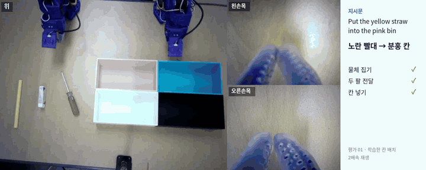
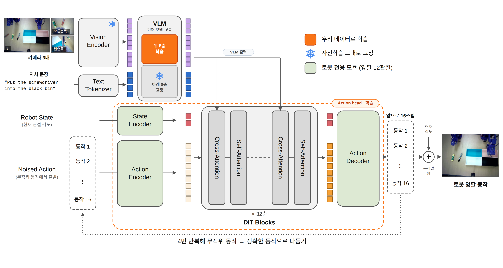
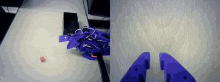
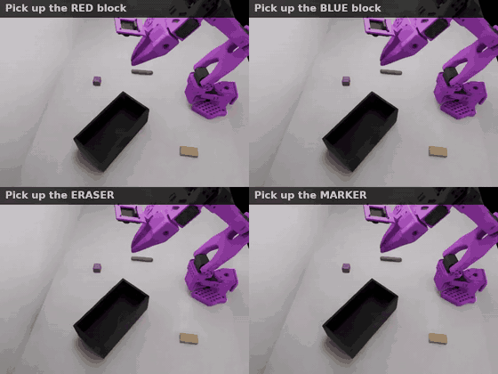
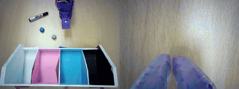

# Bimanual Language-Conditioned Sorting — SO-ARM101 × GR00T N1.6

양팔 SO-ARM101 로봇이 영어 지시문 한 문장을 읽고 물체를 골라 집어, 다른 팔에 건네고, 지시한 색의 칸에 넣는다.
NVIDIA GR00T N1.6(3B VLA)을 양팔 12관절·카메라 3대에 맞춰 미세조정했다.

[](envs/lerobot/pyproject.toml)
[](envs/lerobot/pyproject.toml)
[](https://github.com/huggingface/lerobot)
[](https://github.com/NVIDIA/Isaac-GR00T)
[](https://github.com/bbanggang0070/manipulator_ws/releases/tag/capstone-final)
[](LICENSE)

<p align="center">
  
  <br>
  <sub>"Put the yellow straw into the pink bin" — 오른팔이 빨대를 골라 집어 왼팔에 건네고, 왼팔이 분홍 칸에 넣는다 (3배속)</sub>
</p>

## 목차

- [개요](#개요)
- [결과](#결과)
- [시스템 구성](#시스템-구성)
- [시작하기](#시작하기)
- [사용법](#사용법)
- [프로젝트 구조](#프로젝트-구조)
- [개발 과정](#개발-과정)
- [문제 해결](#문제-해결)
- [로드맵](#로드맵)
- [참고 자료](#참고-자료)
- [라이선스](#라이선스)

## 개요

```
"Put the {물체} into the {색} bin"
   ├─ ① 오른팔 — 물체 분류: 테이블 위 1~4개 중 지시한 물체를 골라 집는다
   ├─ ② 전달   — 오른팔이 들고 와 왼팔 그리퍼에 직접 건넨다
   ├─ ③ 왼팔   — 색 분류: 2×2 칸 중 지시한 색의 칸에 넣는다
   └─ ④ 양팔이 rest 로 돌아와 멈추면 종료
```

문장 하나가 두 팔을 함께 조건화한다 — 오른팔은 **물체 분류**, 왼팔은 **색 분류**를 맡는다.

| 구분 | 구성 |
|---|---|
| 물체 8종 | red · blue · black marker, yellow straw, glue stick, toothbrush, eraser, screwdriver (한 시행에 1~4개) |
| 칸 4색 | black · cyan · pink · white — 2×2 보관함. **50ep 마다 색 배치를 바꿔** 수집 (6종) |
| 지시문 | 8 × 4 = **32종** |
| 데이터 | 리더암 양팔 teleop 시연 **392회**(약 4시간) = 기본 300 + 같은 배치·다른 지시문 대조 시연 92 |
| 모델 | GR00T N1.6-3B — VLM 위 8층 + Action head 학습, 나머지 사전학습 고정 |

**이 저장소가 제공하는 것**

- 수집 → 변환 → 학습 → 서빙 → 평가까지 재현 스크립트 (`setup/`)
- 수집 계획표와 모델별 평가 결과 CSV (`records/`)
- 최종 발표 자료와 구조·학습·추론 흐름 애니메이션 (`docs/`)
- 차후 계획 — 강화학습 보정([DSRL_PLAN.md](DSRL_PLAN.md)) · 모델 경량화([LIGHTWEIGHT_PLAN.md](LIGHTWEIGHT_PLAN.md))

## 결과

최종 모델 `gr00t_bi_cleanup392_llm8_n16_8bit` — **평가 B 60회** (학습에 없던 칸 배치 24회 포함)

| 지시한 물체를 집음 | 두 팔 전달 | 지시한 칸에 넣음 | **완전 성공** | 처음 보는 칸 배치 |
|:---:|:---:|:---:|:---:|:---:|
| **82%** (49/60)<br><sub>우연 약 35%</sub> | 88% (53/60) | **94%** (50/53)<br><sub>우연 25%</sub> | **73%** (44/60)<br><sub>95% CI 61~83% · 목표 70%</sub> | 20/24 완전 성공 |

- 같은 60회를 기본 모델(300ep · VLM 4층)과 짝지어 비교: 이 모델만 성공 19회 vs 기본 모델만 성공 2회 (McNemar p < 0.001)
- 추론 지연: RTX 5070 Ti 에서 청크(16스텝)당 70~90ms, 앞 8스텝 실행 후 다시 계획
- 남은 실패 16회: 다른 물체를 집음 8 (마커끼리 혼동 5) · 못 집거나 전달 중 놓침 6 · 칸 틀림 2

| 발표 자료 | |
|---|---|
| 인쇄용 슬라이드 (PDF) | [docs/slides/capstone_print.pdf](docs/slides/capstone_print.pdf) |
| 발표본 PPTX (애니메이션·영상 포함) · 시연 영상 50초 | [Release `capstone-final`](https://github.com/bbanggang0070/manipulator_ws/releases/tag/capstone-final) |
| 웹 슬라이드 (구조·학습·추론 흐름 영상) | [docs/slides/index.html](docs/slides/index.html) |

## 시스템 구성

### 모델



<sub>주황 = 우리 데이터로 학습한 부분(VLM 위 8층 + Action head), 눈송이 = 사전학습 그대로 고정.
흐름 영상: [학습](docs/diagrams/anim/train_flow_n16.mp4) · [추론](docs/diagrams/anim/infer_flow_n16.mp4)</sub>

| 항목 | 값 | 근거 |
|---|---|---|
| 출발점 | NVIDIA GR00T N1.6-3B 공개 가중치 | 기존 과제 모델에서 이어 학습하면 언어를 못 배움 (P4: 22.5% vs 47.5%) |
| 학습 범위 | VLM 위 **8층** + Action head(DiT 32층) | 층별 프로브 — 지시 단어를 화면 물체와 잇는 층이 4층 범위 밖 |
| 손실 | flow matching | GR00T action head 기본. 추론 시 4단계로 노이즈를 걷어 냄 |
| 옵티마이저 | paged AdamW **8-bit**, lr 1e-4 cosine, warmup 5% | 3B 미세조정을 RTX 5090 32GB 한 장에 맞춤 |
| 배치 · 학습량 | 64 (2 × 누적 32) · **10 epoch** (392ep 기준 69,000 step) | 32 epoch 는 loss 5.6배 낮지만 기존 과제 76.7 → 60% (과적합) |
| 증강 | 밝기·대비·채도 + 색조 **±5.4°** 만 | 색조를 크게 돌리면 색 단어와 화면 색의 대응이 깨짐 |
| 실행 | 시간 앙상블 W = 0.8, 16스텝 중 8스텝 실행 | W 0.3 은 물체 사이에서 멈춤(물체 70%) → 0.8 에서 90% |

### 파이프라인

```
[수집·학습]  리더암 teleop ─▶ LeRobot v3.0 ─▶ (5090) v2.1 변환·검사 ─▶ 학습 10 epoch ─▶ 체크포인트 rsync ─▶ 로컬
[추론]       카메라 3 + 관절 12 + 지시문 ─ZMQ tcp:5555─▶ 정책 서버 ─▶ 16스텝 × 12 청크 ─▶ 시간 앙상블 ─▶ 양팔
```

### 하드웨어

| 장비 | 사양 |
|---|---|
| 팔로워 · 리더 | SO-ARM101 × 2 + 리더 × 2 (각 5관절 + 그리퍼 → 상태·행동 12차원) |
| 카메라 | USB × 3 — 위 · 왼손목 · 오른손목, 640×480 **MJPG** |
| 로컬 PC | RTX 5070 Ti 16GB — 수집 · 실기 제어 · **추론 서빙** |
| 원격 PC | RTX 5090 32GB — GR00T **학습** · Isaac Sim 무인 평가 (P1~P4) |

## 시작하기

### 요구 사항

- Ubuntu, NVIDIA GPU (추론 16GB · 학습 32GB), CUDA 12.8+ (Blackwell 은 필수)
- [uv](https://docs.astral.sh/uv/), Docker, ffmpeg
- [Sim-to-Real-SO-101-Workshop](https://github.com/NVIDIA/Sim-to-Real-SO-101-Workshop) — GR00T 서빙 이미지와 데이터 변환 도구 (`~/blocktask_ws/` 에 클론)

### 설치

```bash
git clone https://github.com/bbanggang0070/manipulator_ws.git && cd manipulator_ws

# 1. 로봇 제어 환경 (Python 3.10 · lerobot 0.4.4 · torch 2.10 cu128)
cd envs/lerobot && uv sync && cd ../..

# 2. 장치 경로 고정 — 팔 4대 · 카메라 3대
setup/hardware/identify_devices.sh                # 식별 정보 확인 → 99-lerobot.rules 에 채움
sudo cp setup/hardware/99-lerobot.rules /etc/udev/rules.d/
sudo udevadm control --reload-rules && sudo udevadm trigger

# 3. 시스템 의존성
sudo apt install ffmpeg

# 4. 워크숍 저장소 패치 + 서빙 이미지 (최초 1회)
cd ~/blocktask_ws/Sim-to-Real-SO-101-Workshop
git apply ~/manipulator_ws/setup/p1_p4_sim/patches/workshop_local_changes.patch          # recorder VRAM 누수 수정
patch -p0 docker/real/Dockerfile.blackwell < ~/manipulator_ws/setup/p1_p4_sim/patches/dockerfile_blackwell_flashattn.patch
./docker/real/build.sh blackwell
```

데이터셋과 체크포인트(각 약 9GB)는 저장소에 포함하지 않는다 — `~/blocktask_ws/Sim-to-Real-SO-101-Workshop/datasets/_train/`, `~/gr00tn16_ws/checkpoints/`.

## 사용법

학습은 5090, 수집·추론은 로컬에서 한다. 5090 쪽 `train_*.sh` 는 5090 작업 폴더에 복사해 실행한다.
각 스크립트 머리말에 옵션과 이유가 있다.

### 1. 수집

```bash
cd setup/p6_real_bimanual/data
python3 gen_bi_plan.py --episodes 300 --layout-every 50   # 계획표 — 50ep 마다 칸 색 배치 교체
./record_bi.sh                                            # 계획표 순서대로 시연 (중단 후 재실행하면 이어서)
python3 gen_bi_contrast_plan.py                           # 대조 시연 92ep 계획표 (같은 배치·다른 지시문)
PLAN=~/manipulator_ws/records/p6_real_bimanual/bi_cleanup_plan_400.csv ./record_bi.sh
(cd ../../../envs/lerobot && uv run python ../../setup/p6_real_bimanual/data/handoff_events.py --report <데이터셋>)  # 전달 검사
```

### 2. 변환 · 학습

```bash
./prepare_bi_cleanup.sh all        # 5090 전송 → v2.1 변환 → 검사 (지시문 32종 · 4색 · 카메라 3대)
# (5090)
SMOKE=1 ./train_bi_cleanup.sh                                   # 짧게 돌려 확인
EPOCHS=10 LLM_TOP_LAYERS=8 OUT_NAME=<이름> ./train_bi_cleanup.sh # 본 학습
```

### 3. 서빙 · 추론 · 평가

```bash
cd setup/gr00t && ./serve_local.sh <모델>/checkpoint-<step>    # 로컬 서빙 (원격이면 SERVER_HOST=<5090 IP>)
cd ../p6_real_bimanual/data
python3 cleanup_eval_bi.py log --eval-name <이름> --out <결과.csv> --rerun                       # 평가 A 36회
python3 cleanup_eval_bi.py log --plan ../../../records/p6_real_bimanual/bi_cleanup_eval_plan_B.csv \
                               --eval-name <이름> --out <결과.csv>                              # 평가 B 60회
python3 cleanup_eval_bi.py report --out <결과.csv>
python3 compare_eval_bi.py --eval B                           # 모델 짝 비교 (McNemar)
```

추론 중 `q` 로 그 시행을 끝내고 결과 입력으로 넘어간다. 어떻게 끝나든 팔은 그 자리에 멈춘 뒤 천천히 rest 로 돌아가고 토크를 유지한다.

<details>
<summary>이전 단계 — 단일팔 분류 (P5) · sim 블록 과제 (P1~P4)</summary>

```bash
# P5 단일팔 분류
cd setup/p5_real_cleanup
./check_setup.sh cams && python3 gen_real_lang_plan.py && ./record_real_lang.sh
./prepare_cleanup_real.sh all            # (5090) EPOCHS=8 ./train_cleanup_real.sh
cd ../gr00t && ./serve_local.sh gr00t_cleanup_real_n16_8bit/checkpoint-30000
cd ../p5_real_cleanup && python3 cleanup_eval.py log && python3 cleanup_eval.py report

# P1~P4 sim 블록 과제 (setup/p1_p4_sim/t1_task)
#  P1·P2  blocktask_run.sh record → prepare_blocktask_gr00t.sh → ../train_gr00t_sim_n16_8bit.sh → blocktask_sim_eval.sh
#         launch_cotrain.py (sim + 실기 co-training)
#  P3     configure_scene.py · run_evalB.sh (고정 패널 15조건) · train_gr00t_blocktask_cotrain_v4_n16_8bit.sh
#  P4     gen_lang_collect_plan.py → blocktask_collect_lang.sh → train_gr00t_blocktask_lang_n16_8bit.sh → run_eval_lang.sh
#         언어 프로브: setup/gr00t/probe_language.py · run_probe_sweep.sh
```
</details>

### 비용 실측

| 항목 | 값 |
|---|---|
| 실기 teleop 수집 | 약 2.3분/ep (양팔 392ep ≈ 4시간 분량) |
| 데이터 준비 (전송 · 변환 · 검사) | 약 40분 |
| 학습 (5090, 8-bit) | 1,000 step 당 약 48분 → 392ep 10 epoch(69k step) ≈ 55시간 |
| 체크포인트 | 약 9GB / 개 |

## 프로젝트 구조

```
manipulator_ws/
├─ README.md
├─ DSRL_PLAN.md · LIGHTWEIGHT_PLAN.md   # 차후 계획 — 강화학습 보정 · 모델 경량화
├─ setup/                    # 재현 스크립트
│  ├─ hardware/              #   udev rules · 장치 식별 · 카메라 점검 · teleop
│  ├─ gr00t/                 #   정책 서버 · 추론 클라이언트 · 카메라 정렬 · 언어 프로브 (P2~P6 공통)
│  ├─ p1_p4_sim/             #   Isaac Sim 블록 과제 — 수집·변환·학습·무인 평가 · patches/ (워크숍 저장소 패치)
│  ├─ p5_real_cleanup/       #   단일팔 분류 — 점검 · 계획표 · 수집 · 검증 · 학습 · 평가
│  └─ p6_real_bimanual/      #   양팔 분류 — data/ (계획표·수집·전달 검사·평가) · gr00t/ (설정·학습·서빙·추론)
├─ records/                  # 수집 계획표 · 평가 결과 CSV (스크립트가 읽고 쓰는 위치)
│  ├─ p4_language_sim/       #   sim 언어 평가 P1~P8 · 언어 프로브
│  ├─ p5_real_cleanup/       #   단일팔 평가 · 칸 교체 검증 · 앙상블 W 스윕
│  └─ p6_real_bimanual/      #   양팔 계획표 · 평가 A/B (bi392llm8_eval_B.csv = 최종) · 비전 층 프로브
├─ docs/
│  ├─ slides/                #   최종 발표 — 인쇄용 pdf/pptx · 웹 슬라이드 · 시연 클립
│  ├─ diagrams/anim/         #   GR00T N1.6 구조도 · 학습/추론 흐름 영상 · 표지 영상 (생성 스크립트 포함)
│  └─ figures/               #   README 그림
└─ envs/lerobot/             # uv 프로젝트 (lerobot 0.4.4 + torch 2.10 cu128)
```

| 단계 | 데이터셋 | 최종 모델 (checkpoint) |
|---|---|---|
| **P6** | `bi_cleanup` 392ep | **`gr00t_bi_cleanup392_llm8_n16_8bit`** (69000) · 비교 `gr00t_bi_cleanup392_n16_8bit` (4층) · `gr00t_bi_cleanup151_n16_8bit` (28000) |
| P5 | `cleanup_real` 370ep · 지시문 40종 | `gr00t_cleanup_real_n16_8bit` (30000) |
| P3 | `sim_so101_blocktask_v4_200` + `..._real_v2_57` | `gr00t_blocktask_cotrain_v4_n16_8bit` (48000) |

## 개발 과정

sim 에서 **물체 하나를 상자 하나에** 넣는 것부터 시작해, 막힐 때마다 원인을 찾아 고치며 과제를 넓혔다.
**모델 구조는 한 번도 바꾸지 않았다** — 바꾼 것은 무엇을 학습하나(출발점·학습 층) · 무엇으로 학습하나(데이터) · 어떻게 실행하나(앙상블)다.

| 단계 | 한 일 | 결과 → 다음 단계로 |
|---|---|---|
| **P1** sim 기본 | Isaac Sim 빨간 큐브 → 검은 상자, teleop 75ep | sim 60% — 큐브 위에서 맴돌며 못 집음 |
| **P2** 데이터 개선 · 실기 전이 | mat 높이 · 교정 시연 보강 (sim 80%), sim + 실기 50ep co-training | 실기 10% → **90%**. 남은 차이는 데이터로 메운다 |
| **P3** 일반화 | 위치 · 박스 무작위화, 블록-상자 근접 보강, 실기 박스 다양화 | sim OOD 82.5% · 실기 80%. 그러나 **지시문을 바꿔도 같은 행동** (학습 지시문 1종) |
| **P4** 언어 조건화 (sim) | 같은 장면 · 다른 지시문으로 수집, 대응쌍 평가 | 파운데이션에서 새로 학습해야 물체 선택 47.5% (우연 25%) |
| **P5** 실기 분류 단일팔 | 4색 칸 · 물체 10종, 실기만 370ep, 앙상블 W 스윕 | 목적지 96.1% · 물체 90%. 칸이 한 배치로만 서 있어 **색이 아니라 위치를 외움** |
| **P6** 실기 분류 양팔 | 오른팔 물체 → 전달 → 왼팔 색. 칸 배치 교체 · 학습 층 · 대조 시연 | **평가 B 완전 성공 73%** |

<table><tr>
<td><br><sub>P2 — sim + 실기 co-training</sub></td>
<td><br><sub>P4 — 같은 배치에서 문장만 바꾸면 다른 물체를 집는다</sub></td>
<td><br><sub>P5 — 단일팔 분류</sub></td>
</tr></table>

<details>
<summary><b>P6 단계별 개선</b> — 0% 에서 73% 까지</summary>

| 모델 | 바꾼 것 | 평가 | 물체 | 칸 | 완전 성공 |
|---|---|---|---|---|---|
| 50ep | 칸 배치 1종 | 6회 | — | — | 0/6 |
| 151ep | 시연 늘림 · 칸 배치 3종 | A 36 | 53% | 33% (우연 수준) | 22% |
| 300ep · VLM 4층 | 칸 배치 6종 (50ep 마다 교체) | A 36 | 50% | **97%** | 44% |
| 300ep · VLM 8층 | 학습 층 확장 | A 36 | 61% | 89% | 44% |
| 392ep · VLM 4층 | 대조 시연 92 추가 | A 36 | 64% | 94% | 53% |
| **392ep · VLM 8층** | 둘 다 | A 36 · **B 60** | 81% · **82%** | 90% · **94%** | 67% · **73%** |

- **칸을 외우던 문제** — 칸 배치를 바꿔 가며 모으자 색을 읽게 됨 (칸 33% → 97%).
- **물체를 헷갈리던 문제** — 모델 속을 열어 원인을 둘로 나눴다.
  - 비전 인코더 출력만으로 마커 3색 구분 AUC 0.98~1.00 → **보는 것은 이미 된다**.
  - 지시 단어를 화면 물체와 잇는 층이 학습 범위 밖 → **학습 층 4 → 8**.
  - 배치만 봐도 집을 물체가 짐작되는 데이터 → **같은 배치에서 지시문만 바꾼 대조 시연 92회**.
  - 2×2 실험(데이터 × 학습 층)에서 둘을 함께 바꾼 모델만 물체 81% — 기본 대비 짝 비교 12 : 1, p = 0.003.
- **남은 실패** (평가 B 16회): 다른 물체 8 (마커끼리 혼동 5, 8회 중 7회가 정면 물체) · 못 집거나 전달 중 놓침 6 · 칸 틀림 2.
  시연이 모두 성공 장면이라 **다시 집는 교정 동작을 배운 적이 없다** → [로드맵](#로드맵).
</details>

> 진행 중 작성한 상세 기록(단계별 계획 · 실행 로그 · 파이프라인 해부 · 발표 구성안)은 정리하며 지웠다.
> 태그 `capstone-final` 에 남아 있다 — `git show capstone-final:PIPELINE.md`, `git show capstone-final:manipulator_md/STATUS.md`

## 문제 해결

| 증상 | 원인 · 조치 |
|---|---|
| 카메라 영상이 깨지거나 멈춤 | `fourcc: MJPG` 확인 (YUYV 는 USB 대역폭 포화), 카메라 3대를 한 허브에 몰지 않는다 |
| 수집 시작 시 캘리브레이션 불일치 | `calib_fingerprint.py --check` 로 수집 전후 대조 — 캘리브레이션이 바뀌면 데이터가 섞인다 |
| 추론 시작 시 오른팔 elbow 처짐 | 홈 이동 뒤 토크 유지 확인 (`goto_home_bi.py`, 홈 자세는 `home_pose_bi.py`) |
| 서버 접속 불가 (5555) | `./serve_local.sh '' logs` 로 준비 여부 확인, 이전 컨테이너가 남았으면 `stop` 후 재기동 |
| 변환 검사에서 지시문 1종 | 변환이 지시문을 하나로 접음 — 학습하지 말고 변환부터 다시 |
| 평가 영상이 웹에서 재생 안 됨 | `ffmpeg -c:v libx264 -pix_fmt yuv420p -movflags +faststart` 로 변환 |
| RTX 50 시리즈에서 torch 오류 | Blackwell(sm_120) 은 CUDA 12.8+ / torch 2.10+cu128 필요. 서빙 이미지는 torch 2.8.0 + flash-attn 사전 wheel 로 고정 |

## 로드맵

| 한계 | 계획 | 문서 |
|---|---|---|
| 시연이 모두 성공 장면이라 놓친 뒤 다시 집지 못함 (실패 6/16) | **강화학습 보정** — GR00T 를 고정하고 출발 노이즈만 학습하는 DSRL, 파지 구간 잔차 RL | [DSRL_PLAN.md](DSRL_PLAN.md) |
| 3B 모델을 5090 에서 약 55시간 학습 — 자원 대비 효율 | **경량화** — VLM 양자화, 0.5B급 소형 VLA (SmolVLA · VLA-Adapter), ACT + 텍스트 대조군, GR00T 교사 증류 | [LIGHTWEIGHT_PLAN.md](LIGHTWEIGHT_PLAN.md) |
| 평가가 모델당 36~60회로 작음 (95% CI ±12%p) | 같은 시행 짝 비교(McNemar)로 모델을 비교 | — |

## 참고 자료

- [NVIDIA Isaac GR00T](https://github.com/NVIDIA/Isaac-GR00T) — GR00T N1.6 모델과 미세조정 코드
- [NVIDIA Sim-to-Real SO-101 Workshop](https://github.com/NVIDIA/Sim-to-Real-SO-101-Workshop) — Isaac Sim 환경, 데이터 변환, 서빙 이미지
- [Hugging Face LeRobot](https://github.com/huggingface/lerobot) — 로봇 제어 · 수집 · 데이터 포맷
- [TheRobotStudio SO-ARM100](https://github.com/TheRobotStudio/SO-ARM100) — SO-ARM101 하드웨어
- Wagenmaker et al., *Steering Your Diffusion Policy with Latent Space RL* (DSRL), CoRL 2025 — [arXiv:2506.15799](https://arxiv.org/abs/2506.15799)

## 라이선스

이 저장소의 코드와 문서는 [Apache License 2.0](LICENSE) 을 따른다.
참고한 [Isaac-GR00T](https://github.com/NVIDIA/Isaac-GR00T) · [LeRobot](https://github.com/huggingface/lerobot) · [SO-ARM100](https://github.com/TheRobotStudio/SO-ARM100) 도 같은 라이선스다.

- GR00T N1.6 가중치는 저장소에 포함하지 않으며 [NVIDIA Open Model License](https://huggingface.co/nvidia/GR00T-N1.6-3B) 를 따른다.
- `docs/diagrams/anim/fonts/` 의 IBM Plex Sans KR 은 [SIL Open Font License 1.1](https://github.com/IBM/plex/blob/master/LICENSE.txt) 이다.

---

캡스톤 디자인 프로젝트 (2026) · 팀 매니큐
