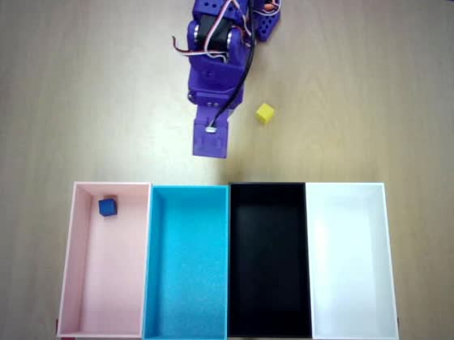

# v4 개선 계획 — v3 평가(checkpoint-30000, 60시행) 분석

작성 2026-10-10 · 사용자 관찰 4건을 궤적 데이터로 검증

---

## 0. v2 → v3 전체 비교

| 지표 | v2 (checkpoint-21000) | v3 (checkpoint-30000) |
| --- | --- | --- |
| 집음 / 넣음 | 88.3% / 86.7% | 85.0% / 85.0% |
| 물체 축 | 71.7% | 70.0% |
| 목적지 축 | 96.2% | 96.1% |
| 타임아웃 비율 | **42%** (25/60) | **27%** (16/60) |
| 성공했는데 타임아웃 | **18건** | **4건** (→ 이번 수정으로 사실상 0 예상) |
| eraser 정확도 | 33% (2/6) | **83%** (5/6) |
| orange→red 오인 | 40% (4/10) | 0건 (평가에서 상호배제) |

물체·목적지 정확도는 v2와 **거의 동일**합니다 — v3가 겨냥한 건 그게 아니라
끝맺음·파지였고, 그 목표는 달성됐습니다(타임아웃 42%→27%, eraser 33%→83%).
사용자가 지적한 4가지는 **정확도 수치에 안 잡히는 종류의 문제**이고, 아래서
궤적으로 하나씩 확인합니다.

---

## 1. "물체 위에서 멈춘다" — ensemble 과평활이 맞습니다

**확인됨.** 못 집은 9건 중 물체 근처에서 1°미만으로 48초 넘게 얼어붙은 사례가
다수입니다(trial15: 53.5초 중 52.5초를 한 자리에서, trial11: 46.3초).

영상으로도 확인됩니다 — trial15는 100프레임과 250프레임(5초 간격)이 픽셀 단위로
거의 동일합니다. 완전 정지가 아니라 **좁은 범위를 맴도는** 형태입니다.

원인은 `run_eval_real.sh`에 이미 측정돼 있던 트레이드오프입니다(다른 모델
기준이지만 메커니즘은 아키텍처 레벨이라 적용됩니다):

| ENSEMBLE_W | 평균 정지 | 최장 정지 | 튐 |
| --- | --- | --- | --- |
| **0.3 (v3 전체 시행에 사용)** | **24.8s** | 14.0s | 2.55° |
| 0.6 | 42.9s | 14.1s | 2.34° |
| 0.8 | 11.0s | 5.1s | 3.36° |
| ENSEMBLE=0 | 6.5s | 2.8s | 9.02° |

W가 낮을수록(=옛 청크를 더 많이 섞을수록) 평균을 내는 예측이 서로 상쇄돼
"결정을 못 내리는" 상태가 길어집니다. v3 60시행은 **전부 W=0.3**으로 돌았고,
이는 표에서 두 번째로 나쁜 설정입니다.

**조치: W를 올려 재평가.** `ENSEMBLE_W=0.6` 또는 `0.8`로 20~30시행만
다시 돌려 정지 빈도·길이가 줄어드는지 본다. 이 모델(cleanup) 전용 표가
없으므로 — 지금 표는 co-train blocktask 모델 실측이다 — **이 모델로
다시 재야 숫자를 믿을 수 있다.** 재학습 없이 되는 가장 싼 실험이다.

---

## 2. "잘못 넣고 물체가 남아 있으면 방황" — 확인됨, 드뭅니다(2/60)

잘못된 칸에 넣은 시행은 **2건**(trial8, trial57)뿐이었는데, 둘 다 방황이
보였습니다.

- **trial57**: pink 지시인데 white에 놓음(9.4초 시점). 이후 15.8초 동안
  **pan 60.8° 범위**를 오가다 25.1초에 끝남. 화면엔 못 넣은 yellow cube·
  green cube가 남아 있었다.
- **trial8**: pink 지시인데 white에 놓음(36.9초 시점). 이후 16.6초 동안
  pan 18.3° 범위를 오가다 53.5초 타임아웃.

**빈도가 낮아 통계적으로 단정하기는 이르지만**(2/60 = 3%), 방향은 사용자
관찰과 일치합니다. 오배치 자체가 드물어서(목적지 축 96.1%) 이 실패 양상도
자연히 드뭅니다.

**조치는 우선순위가 낮습니다.** 오배치율을 더 낮추는 게 먼저고(이미 96%),
"잘못 넣은 뒤 복구"를 가르치는 시연은 지금 수집 방식에 없는 **새로운 종류의
데이터**라 비용이 큽니다. v4 수집에서 급하지 않다면 보류를 권합니다.

---

## 3. "다른 색 cube를 먼저 보면 그 위에서 정지" — 확인됨, wrist 카메라로 직접 봤습니다

**trial11** (지시: "Put the **orange** cube into the cyan bin", 화면:
orange cube·screwdriver·green cube)의 wrist 카메라를 보면, 그리퍼가
**screwdriver 축 사이에 정확히 걸린 채** 46초 넘게 멈춰 있습니다. orange
cube는 화면 한쪽에 그대로 남아 있습니다.

top 카메라로는 green cube 옆에서 멈춘 것처럼 보이지만(100·250프레임이
거의 동일), wrist 카메라가 실제 조준 지점(screwdriver)을 보여줍니다 —
물체 자체를 못 알아본 게 아니라 **가장 먼저 닿는 범위에 들어온 물체에
멈춘 뒤 다음으로 넘어가지 못하는** 패턴입니다.

이건 1번과 **같은 메커니즘의 다른 증상**일 가능성이 있습니다. ensemble이
과평활 상태에서는 "이 물체가 아니다 → 다른 데로 이동"이라는 **재판단**이
느려집니다. 즉 1번(과평활)의 재발 테스트가 3번도 함께 검증할 가능성이 큽니다.

**조치: 1번과 같은 실험(W 조정)으로 함께 관찰.** 별도 수정은 보류하고,
W를 올린 재평가에서 "엉뚱한 물체 위 고착" 빈도도 같이 센다. 그래도 남으면
그때 "방해물 중 비슷한 형상에서 벗어나기" 시연을 늘리는 쪽으로 간다
(marker/screwdriver처럼 가늘고 긴 것 위주).

---

## 4. "성공했는데 타임아웃" — 원인 찾아 고쳤습니다 (재학습 불필요)

**이미 수정·커밋 완료.** `STOP_ON_REST`가 "전체 관절이 6° 안에 들어와야
멈춤"으로 판정하고 있었는데, 성공한 4건(trial27·29·30·39)을 전수 조사하니
**wrist_roll 하나만** 6~12°(평균 9.5°) 어긋난 채 완전히 안정돼 있었습니다 —
흔들리는 게 아니라 그 값에 고정. 나머지 5관절(pan·lift·elbow·wrist_flex·
gripper)은 전부 1~3.5° 안이었습니다.

원인: wrist_roll은 물체를 놓는 성패와 무관한 자유도이고, 수집 데이터의
rest 자세 자체도 wrist_roll 표준편차가 ±2.5~2.7°(그리퍼는 ±0.3°)로 가장
느슨했습니다. 모델이 유독 이 축만 못 맞추는 게 아니라, 애초에 "정밀하게
맞출 필요가 없다고 배운" 축입니다. 그런데 전역 6° 임계값 하나로 재면 이
관절이 매번 병목이 됩니다(60시행 중 6건, 10%가 "다른 관절은 다 됐는데
wrist_roll만 기준 초과").

**수정**: wrist_roll만 15°로 느슨하게, 나머지는 기존 6° 유지
(`REST_BACK_WROLL_DEG` 환경변수로 조정 가능). 4건의 실제 궤적에 새 기준을
시뮬레이션하니 **17.9~42.5초에 정상 종료**됐을 것으로 재현됐습니다(기존은
53~54초 타임아웃).

이 수정은 재학습도 재수집도 필요 없습니다 — 다음 평가부터 바로 적용됩니다.

---

## 5. 우선순위별 실행 계획

| 순서 | 작업 | 비용 | 기대 효과 |
| --- | --- | --- | --- |
| **1** | wrist_roll 복귀 임계값 완화 | **완료** (0) | "성공+타임아웃" 4건 → ~0건 |
| **2** | `ENSEMBLE_W` 스윕 재평가 (0.3/0.6/0.8, 각 15~20시행) | 재학습 없음, 1~2시간 | 1번·3번(과평활 정지·물체 고착) 동시 검증 |
| 3 | 스윕 결과로 기본 `ENSEMBLE_W` 확정 | 0 | 향후 모든 평가·데모에 반영 |
| 4 (보류) | 오배치 복구 시연 수집 | 신규 수집 필요 | 2번 — 빈도 낮아 우선순위 낮음 |

**다음 할 일**: `ENSEMBLE_W=0.6`과 `0.8`로 각각 15~20시행씩 재평가를 돌려
정지 빈도·길이와 "엉뚱한 물체 고착" 빈도를 직접 잰다. 체크포인트는
바뀌지 않으므로 서빙은 그대로 두고 클라이언트 설정만 바꿔 돌리면 된다.

---

## 6. ENSEMBLE_W 스윕 결과 (2026-10-10, 각 10시행)

1번(과평활 정지)·3번(엉뚱한 물체 고착) 검증을 위해 물체 3~4개짜리 장면만
골라 W=0.6, W=0.8로 각 10시행씩 돌렸다. v3 60시행(W=0.3)과 비교:

| | W=0.3 (v3, n=60) | W=0.6 (n=10) | W=0.8 (n=10) |
| --- | --- | --- | --- |
| 물체 축 | 70.0% | 70% | **90%** |
| 타임아웃 | 27% | 20% | 20% |
| 최장 배회 | 최대 52.5초 | 12.2초 | 17.8초(1건 예외) |
| 길이 중앙 | — | 32.4초 | **24.0초** |

**1번(과평활 정지) 결론: 확인되고 해결됐다.** W를 올리자 "한 자리에서
50초 넘게 얼어붙는" 사례가 사라졌다(최장 배회가 52.5초 → 12~18초로).
n=10이라 작지만 방향이 뚜렷하고 메커니즘과도 일치한다.

**조치: 기본 `ENSEMBLE_W`를 0.3 → 0.8로 변경(완료, 커밋됨).**
`cleanup_eval.py`의 기본값을 바꿨다. 다음 평가부터 자동 적용된다.

### 남은 타임아웃 4건 — wrist_roll과 다른, 새로운 실패 유형

`REST_BACK_JOINT` 수정(§4) 이후에도 4건이 타임아웃했는데, 궤적을 보니
**다른 원인**이었다. wrist_roll만 어긋난 게 아니라 elbow가 140~160°,
lift가 76~145° 어긋난 **완전히 다른 자세**다. 그중 w06-trial6은 끝까지
초당 11°씩 계속 움직이고 있었다 — 멈춘 게 아니라 **정말로 작업을 계속하는
중**이었다.

주목할 점: 이 중 **2건은 물체·목적지 모두 성공**이었다(w06-trial6: red cube
→ pink 정답, w08-trial8: eraser → white 정답). 사용자 메모에 "eraser가
gripper에서 안 떨어진 줄 알고 place 상태에서 고정"이라고 적혀 있는데, 이게
정확한 설명일 가능성이 높다 — **작업은 끝났지만 "집으로 돌아가라"는
동작 자체를 정책이 만들어내지 않는** 경우로 보인다.

이건 그때그때 돌릴 수 있는 클라이언트 수정으로 못 고친다. 그리퍼 임계값
기반 감지를 또 하나 만드는 건 이 세션에서 이미 네 번 틀렸던 방식이라
섣불리 손대지 않는다. **미해결로 남긴다** — 다음 데이터 수집 때 "작업 완료
후 반드시 rest까지 복귀"가 안정적으로 들어가도록 시연 품질을 보는 수밖에
없다(지금 검증기의 끝맺음 검사가 이미 이 지표를 보고 있다 — §9 참고).

**3번(엉뚱한 물체 고착) 결론: 1번과 함께 개선된 것으로 보이나 직접 재현
사례는 이번 스윕에서 뚜렷하게 나오지 않았다.** W=0.6 trial3·4가 다른
물체를 집었지만(orange cube→screwdriver, green cube→screwdriver) 고착
없이 작업을 끝까지 진행했다(각 22.5초, 53.4초) — "멈춤"이 아니라
"판단 자체가 틀렸다"에 가깝다. v3의 trial11(스크류드라이버에 46초 고착)
같은 극단 사례는 이번 20시행에 재현되지 않았다. 표본이 작아 단정은 이르다.

### MAX_SEC 유지 (60초)

정상 종료된 16건의 최대 길이가 43.7초였다(90분위 37.5초). 60초에는 아직
16초 여유가 있어 **지금 낮추면 정상 작업을 자를 위험**이 있다. 표본이
16개뿐이라 섣불리 줄이지 않는다.

---

## 7. 색지 교체 검증 — 최종 결론 (2026-10-14, 53/96시행에서 중단)

### 진행 중 발견한 방법론 오류 — 바로잡음

최초 분석(대화 중)에서 "white 지시 80%가 **학습 때 위치(물리 4번)로** 간다"고
결론 냈으나, L2·L3·L4 전환 시점 사진을 직접 대조하니 **실제 물리 배치가
의도한 배치의 정확한 좌우 반전**이었다(3곳 전부 확인). 배너의 "1번=왼쪽"
표기가 실제 설치 때 반대로 적용된 것으로 보인다. 반전을 반영해 재계산하니
"학습 위치로 간다"는 설명은 더 이상 성립하지 않았다 — **새로 찾은 패턴은
다르다.**

### 바로잡은 결론 — "학습 위치 암기"가 아니라 "맨 왼쪽 칸 기본값"

| 배치 | white 지시 | 착지 물리 위치 |
|---|---|---|
| L2 (4건) | 전부 **물리 1번**(그 칸 색=pink) | 정답은 물리 4번(white) |
| L3 (4건) | 전부 **물리 1번**(그 칸 색=cyan) | 정답은 물리 3번(white) |
| L4 (2건) | **물리 2번**(정답) | 정답과 일치 |

L2·L3는 착지한 **색이 서로 다른데**(pink vs cyan) **물리 위치는 똑같이 1번**이다.
즉 "학습 때 white가 있던 자리를 기억한다"가 아니라, **white를 확신하지
못할 때 맨 왼쪽 칸으로 기본 이동하는 경향**으로 보인다. L4에서는 white가
물리 2번(왼쪽에서 두 번째, 가까운 자리)이라 2/2 정답이었다 — 위치가 멀거나
가까운 것과도 관련 있을 수 있다.

trial 24 메모: *"pink와 white가 rgb 계열이 비슷하여 헷갈리는 거 같음"* —
white는 채도가 없어 시각 신호가 가장 약한 색이라는 가설과도 맞는다.

> trial24(L2) — "Put the blue cube into the **white** bin". 실제 배치
> pink·cyan·black·white(왼쪽→오른쪽). 파란 큐브는 **맨 왼쪽 pink 칸**에
> 들어갔다 — 정답(맨 오른쪽 white)과는 멀고, L2의 다른 white 지시 3건도
> 전부 같은 물리 1번에 착지했다.

흑·청록·분홍은 전혀 다른 양상이다(위치암기/오류율 0~14%, 표 §6 참고) —
**편향은 white 하나에 집중**돼 있다는 원래 관찰은 그대로 유지된다. 바뀐 건
"어디로 새는가"의 설명뿐이다.

### 다음 수집에 반영할 것

제안대로 **다음 데이터셋 수집에서 선반을 여러 물리 배치로 바꿔가며 시연을
모은다.** 지금 모델은 학습 내내 선반이 고정된 한 배치(1=black·2=cyan·
3=pink·4=white)로만 서 있었다 — "색"과 "그 색이 늘 있던 자리"가 통계적으로
완전히 얽혀 있어, 분리해 배우지 못했을 가능성이 크다. 수집 때 선반 배치를
몇 가지로 돌려가며(예: 전체 반전 1종만 섞어도) 찍으면, 같은 색 단어가
서로 다른 물리 위치와 짝지어지는 경험이 생겨 "색 자체"를 읽는 쪽으로
끌어당길 수 있다. white 같이 채도가 약한 색은 수집 비중을 추가로 높이는
것도 고려할 만하다.

### 남은 것 (중단 시점)

53/96시행(L1~L4, L4는 5/16만). L5·L6 미착수. L5는 설계상 "전체 반전"이라
**만약 물리 설치도 똑같이 반전되어 들어간다면 L1과 구분 불가능해지는 결함**이
있다 — 재개한다면 L5 물리 배치를 사진으로 먼저 확인할 것.
